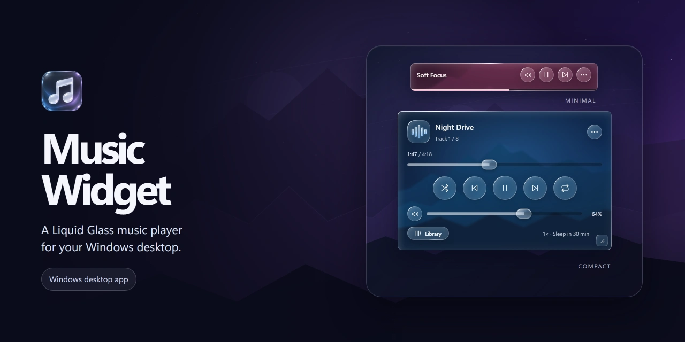

# Music Widget — Lecteur de musique pour Windows

**Un lecteur de musique gratuit et open source pour Windows, avec un mini-lecteur toujours au premier plan.** Écoute tes fichiers MP3, FLAC, WAV et M4A hors ligne et organise-les en playlists. Le mode Minimaliste tient sur une ligne. Le mode Compact est redimensionnable et affiche un visualiseur audio. Les deux modes proposent des couleurs Liquid Glass personnalisables.

[**Télécharger pour Windows**](https://github.com/Ryzen446/music-widget/releases/latest/download/MusicWidget-Windows.zip) · [Voir la galerie](README.md#screenshots) · [English](README.md)



## Démarrage rapide

1. Télécharge `MusicWidget-Windows.zip` depuis la [dernière version](https://github.com/Ryzen446/music-widget/releases/latest).
2. Décompresse-le dans un dossier où tu peux écrire et que tu comptes conserver, par exemple `Documents\Music Widget`.
3. Ouvre `Lancer-Widget.vbs`. Pour importer des fichiers audio, ouvre **⋯ → Ajouter de la musique → Lien ou fichier**.

L’archive Windows inclut l’interface compilée. Le widget utilise Windows PowerShell 5.1 et le runtime Microsoft Edge WebView2. Windows 11 est recommandé pour l’effet Acrylic. Si WebView2 manque, installe le runtime Evergreen. [Téléchargement de WebView2](https://developer.microsoft.com/fr-fr/microsoft-edge/webview2/#download)

Appuie sur **Ctrl+Maj+M** pour afficher ou masquer le lecteur. Le menu de l’icône près de l’horloge permet aussi de le rouvrir, d’ouvrir le dossier de musique, de **Démarrer avec Windows** et de quitter.

`Lancer-Widget.bat` peut aussi lancer le lecteur. Pour lire les erreurs de démarrage, exécute cette commande dans un terminal ouvert dans le dossier décompressé.

```powershell
powershell.exe -NoProfile -STA -ExecutionPolicy Bypass -File .\MusicWidget.ps1
```

## Fonctionnalités

- **Deux dispositions.** Le mode Minimaliste tient sur une ligne, avec une barre de progression en bas et six positions à l’écran. Le mode Compact ajoute un visualiseur, davantage de commandes et une fenêtre déplaçable et redimensionnable.
- **Une aura à ton goût.** Utilise une couleur prédéfinie, une couleur personnalisée ou un cycle RGB avec des fondus doux. Les menus suivent la teinte. Un réglage réduit les animations.
- **Des playlists locales.** Recherche tes titres, ajoute-les par lot ou réorganise une playlist à la souris ou au clavier. Tu peux parcourir une playlist pendant que ton morceau continue.
- **Des commandes accessibles.** Configure des raccourcis globaux pour afficher ou masquer le lecteur, mettre en pause, changer de titre, régler le volume ou quitter. Le lecteur propose aussi une minuterie, la vitesse de lecture et le premier plan.
- **Recherche et écoute intégrées.** Avec les outils en ligne facultatifs, découvre des résultats YouTube avec miniatures, écoute avant d’enregistrer et choisis la bibliothèque ou une playlist. Le panneau affiche la progression en octets lorsque la taille totale est disponible.

## Outils en ligne facultatifs

Les fichiers et playlists locaux restent utilisables directement. Pour la recherche, l’écoute en ligne et l’import par lien, crée le dossier `bin` à côté de `MusicWidget.ps1` et place-y le `yt-dlp.exe` officiel pour Windows. Pour une meilleure compatibilité avec YouTube, installe également Deno et vérifie qu’il se trouve dans ton `PATH`. [Versions de yt-dlp](https://github.com/yt-dlp/yt-dlp/releases/latest) · [Configuration du runtime JavaScript](https://github.com/yt-dlp/yt-dlp/wiki/EJS)

Pour convertir les téléchargements en MP3 et analyser les fréquences, ajoute `ffmpeg.exe` et `ffprobe.exe` dans `bin`. Utilise une version statique ou place les DLL correspondantes avec les exécutables. [Versions FFmpeg pour yt-dlp](https://github.com/yt-dlp/FFmpeg-Builds)

**Rechercher** interroge les résultats publics de YouTube. **Lien ou fichier** accepte un fichier local, une URL YouTube ou le lien d’un titre Spotify. Pour Spotify, les métadonnées publiques servent à chercher un résultat correspondant sur YouTube. Télécharge les contenus que tu as l’autorisation d’enregistrer.

## Données locales et lecture en arrière-plan

Le widget fonctionne sans compte ni clé API personnelle. Tes fichiers importés, playlists et réglages restent sur ton PC. La recherche et l’écoute en ligne contactent les services concernés et leurs serveurs d’image ou d’audio.

Quand le widget est masqué, l’audio continue et le rendu WebView2 et le visualiseur se mettent en pause. L’interface existe en français et en anglais. Le réglage automatique suit la langue de Windows si elle est prise en charge et utilise l’anglais dans les autres cas.

## Licence et crédits

Music Widget est distribué sous [licence MIT](LICENSE). Les commandes Liquid Glass utilisent Open Glass UI. Le lecteur repose sur WPF et Microsoft Edge WebView2. Les dépendances distribuées avec le projet conservent leurs licences. [Open Glass UI](https://github.com/moekoelueker/open-glass-ui) · [Licences de l’interface](frontend/licenses) · [Mentions WebView2](lib/webview2)

[Compilation depuis les sources](README.md#build-from-source) · [Galerie complète](README.md#screenshots)
