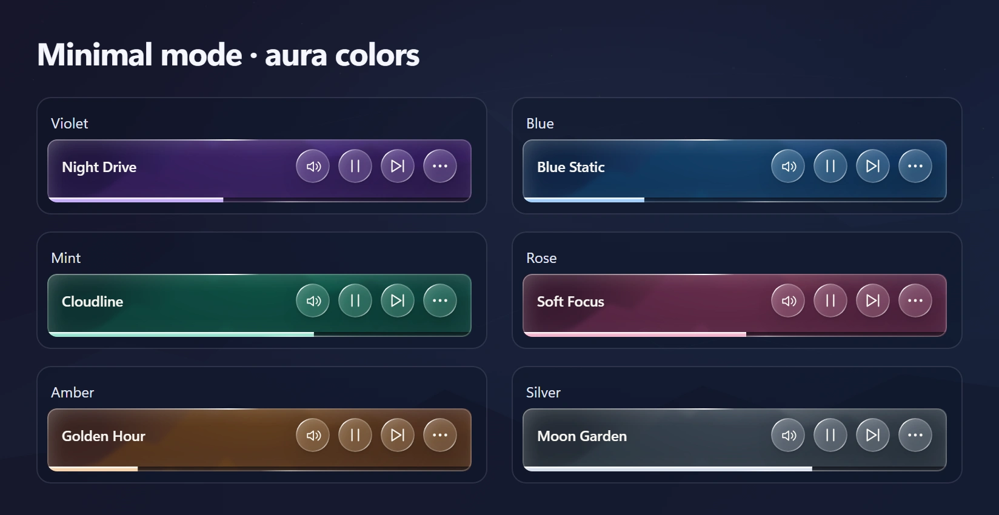
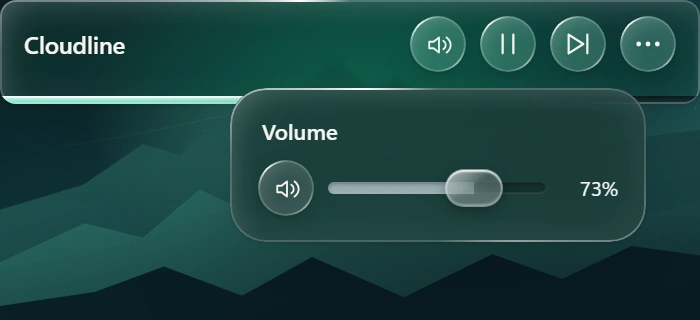
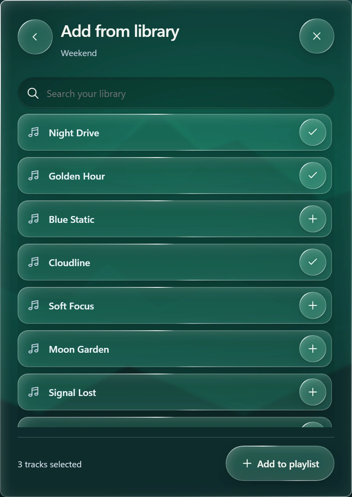
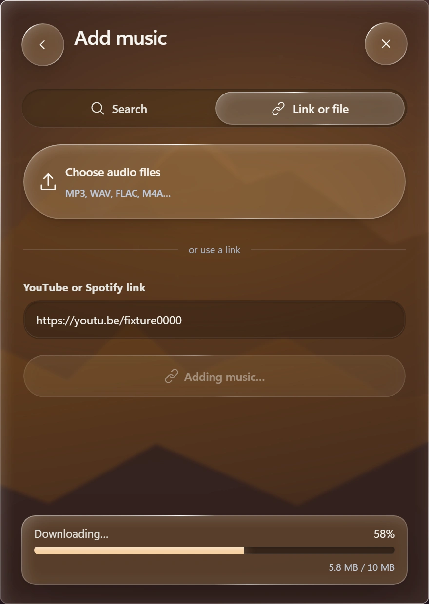
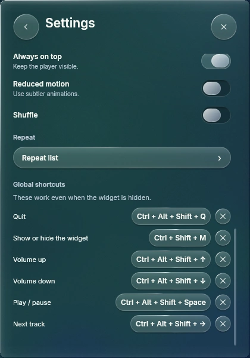

# Music Widget — Local Music Player for Windows

**A free, open-source music player for Windows with an always-on-top mini player.** Play your local MP3, FLAC, WAV and M4A files offline and organize them into playlists. Use the slim Minimalist layout for quick playback controls, or switch to the resizable Compact layout for an audio visualizer. Both layouts have customizable Liquid Glass colors.

[**Windows releases**](https://github.com/Ryzen446/music-widget/releases/latest) · [Quick start](#quick-start) · [Screenshots](#screenshots) · [Français](README.fr.md)


## Quick start

Download and open **[MusicWidget-Setup.exe](https://github.com/Ryzen446/music-widget/releases/latest/download/MusicWidget-Setup.exe)**. Setup checks .NET Framework 4.8 and installs **Music Widget** for your account. The option to enable YouTube playback and downloads is selected by default. Clear it if you only play local files.

For the portable native build, extract `MusicWidget-Native-Portable.zip` into a writable folder and open `MusicWidget.exe`. Windows 11 enables the system Acrylic backdrop when transparency is available. [Windows Acrylic backdrop](https://learn.microsoft.com/en-us/windows/win32/api/dwmapi/ne-dwmapi-dwm_systembackdrop_type)

Open **⋯ → Add music → Link or file** to import local audio.

Press **Ctrl+Shift+M** to show or hide the player. The Music Widget tray menu also lets you reopen the player, open the music folder or choose **Start with Windows**. To exit, select **Quit** from the tray menu.

## What you can do

- **Pick a layout.** Minimalist fits on a single line and offers six screen positions. Compact adds an audio visualizer and a draggable, resizable window.
- **Tint the glass.** Choose presets, a custom color or a slowly changing RGB aura. Menus and controls follow your aura. A reduced-motion setting is available.
- **Organize local music.** Search your library, batch-add tracks to playlists and reorder them by dragging or with the keyboard. Browsing a playlist leaves your current track playing.
- **Control playback from anywhere.** Set global shortcuts for show/hide, play/pause, next track, volume and quit. Adjust playback speed, set a sleep timer and pin the player above other windows.
- **Find music in the player.** With the optional online tools, search public YouTube results with thumbnails, listen before saving, and choose the library or an existing playlist. The download panel shows byte progress when a total size is available.

## Screenshots

### Player and Liquid Glass controls

| Minimalist in different auras | Compact with audio visualizer |
| --- | --- |
| [](docs/screenshots/minimalist-auras.webp) | [](docs/screenshots/compact.webp) |
| **Player menu** | **Volume** |
| [](docs/screenshots/glass-menu.webp) | [](docs/screenshots/volume.webp) |

### Library, playlists and search

| Library | Add multiple tracks to a playlist |
| --- | --- |
| [](docs/screenshots/library.webp) | [](docs/screenshots/playlist-picker.webp) |
| **Search and preview** | **Add from a link or file** |
| [](docs/screenshots/search.webp) | [](docs/screenshots/add-music.webp) |
| **Download progress** | |
| [](docs/screenshots/download.webp) | |

### Personalization and shortcuts

| Glass aura picker | Screen positions |
| --- | --- |
| [](docs/screenshots/aura-picker.webp) | [](docs/screenshots/positions.webp) |
| **Global shortcuts** | **Windows tray menu** |
| [](docs/screenshots/shortcuts.webp) | [](docs/screenshots/tray.png) |

Screenshots use demo tracks and library data.

## Optional online tools

In a build that includes online tools setup, open **⋯ → Add music** and select **Enable online tools**. The app downloads missing copies of yt-dlp, Deno, FFmpeg and ffprobe and verifies their SHA-256 checksums. It stores the tools in `%LOCALAPPDATA%\MusicWidget\Data\bin` for the installed app or in `bin` beside the portable player. Local audio and playlists are available immediately.

You can also place your own copies of the tools in the matching `bin` folder. [yt-dlp releases](https://github.com/yt-dlp/yt-dlp/releases/latest) · [yt-dlp JavaScript runtime setup](https://github.com/yt-dlp/yt-dlp/wiki/EJS) · [FFmpeg downloads](https://ffmpeg.org/download.html)

**Add music → Search** queries public YouTube results. **Link or file** accepts local files, a YouTube URL or a Spotify track link. Spotify gives the widget public track metadata to look for a matching YouTube result. Use the download feature for media you have permission to save.

## Local data and background playback

The app works without a sign-in or personal API key. The installed app keeps playlists, settings and imported audio under `%LOCALAPPDATA%\MusicWidget\Data`. Uninstalling preserves this folder. The portable app stores its data in the extracted folder. Online search, previews and imports contact the relevant services and their thumbnail or audio hosts when used.

If you used a previous portable release, you can copy `musique`, `playlists.json` and `settings.json` from its folder to the installed app’s data directory while Music Widget is closed. If that destination already contains a library, keep a copy before replacing any files.

The player continues playing when the widget is hidden. Title animation, RGB cycling and the visualizer pause when their surfaces are inactive. Automatic language follows supported Windows languages and uses English otherwise.

## Build from source

Build the native C# and WPF executable with Windows PowerShell 5.1 and .NET Framework 4.8 or later on x64 Windows.

```powershell
powershell -NoProfile -ExecutionPolicy Bypass -File .\native\Build-Native.ps1
.\artifacts\native\MusicWidget.exe
```

See the [installer build instructions](installer/README.md) and [startup benchmark](experimental/benchmark/README.md).

## License and credits

Music Widget is released under the [MIT License](LICENSE). The native WPF controls recreate the Liquid Glass styles from the previous Open Glass UI release. Sources for the previous renderer and its dependency notices are available in the repository. [Open Glass UI](https://github.com/moekoelueker/open-glass-ui) · [Frontend licenses](frontend/licenses) · [WebView2 notices](lib/webview2)
