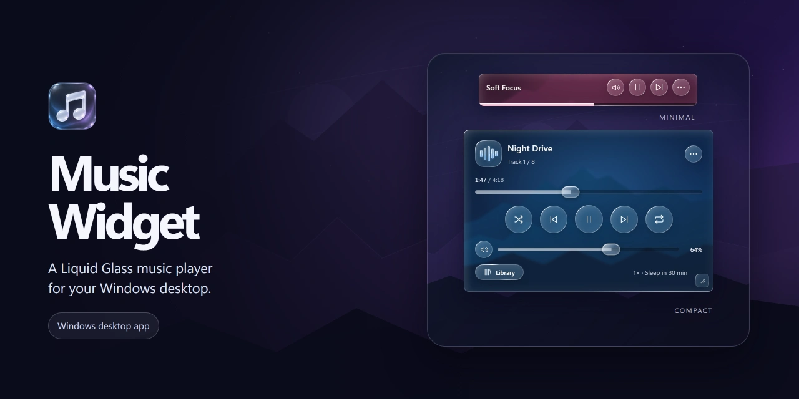
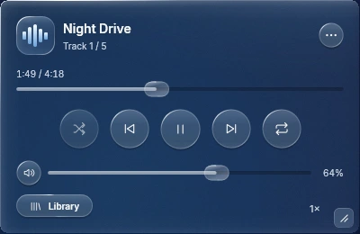
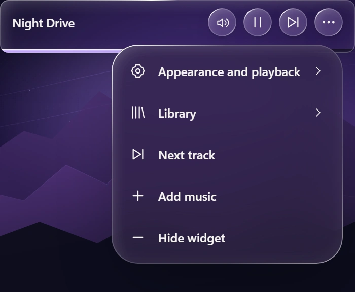
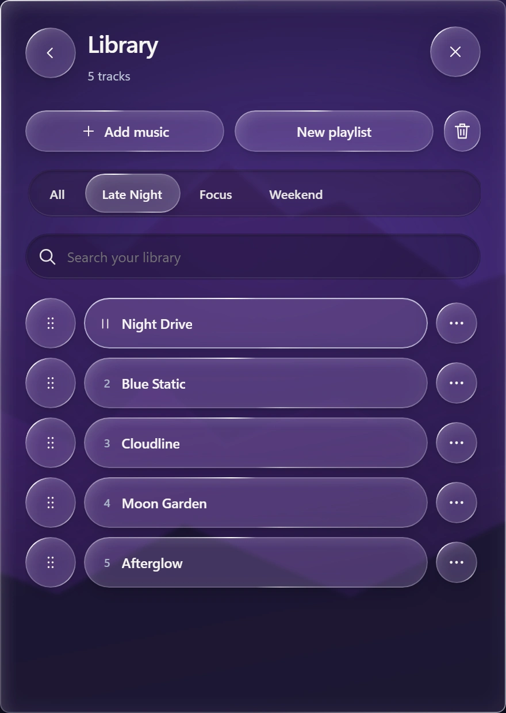
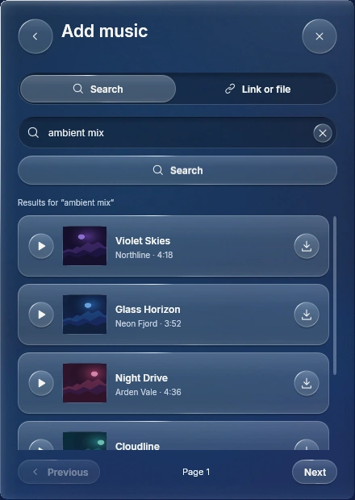
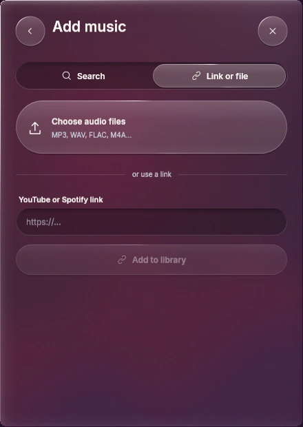
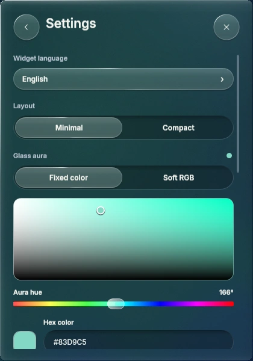
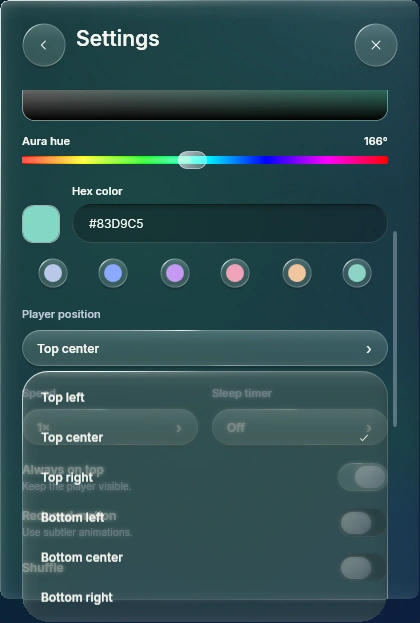
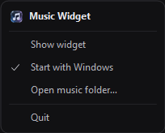

# Music Widget

**A Liquid Glass music player for your Windows desktop.** Play local audio, organize playlists and keep playback controls within reach. Choose a single-line widget or a resizable player, then tint the glass to suit your desktop.

[**Download for Windows**](https://github.com/Ryzen446/music-widget/releases/latest/download/MusicWidget-Windows.zip) · [Quick start](#quick-start) · [Screenshots](#screenshots) · [Français](README.fr.md)



## Quick start

1. Download `MusicWidget-Windows.zip` from the [latest release](https://github.com/Ryzen446/music-widget/releases/latest).
2. Extract it to a folder you can write to and keep, such as `Documents\Music Widget`.
3. Open `Lancer-Widget.vbs` to launch it. Open **⋯ → Add music → Link or file** to import local audio.

The portable Windows package includes the built interface and launches without an installer. It uses Windows PowerShell 5.1 and the Microsoft Edge WebView2 Runtime. Windows 11 is recommended for the Acrylic backdrop. If the runtime is missing, install the Evergreen Runtime. [Microsoft WebView2 downloads](https://developer.microsoft.com/en-us/microsoft-edge/webview2/#download)

Press **Ctrl+Shift+M** to show or hide the player. The Music Widget tray menu also lets you reopen the player, open the music folder or choose **Start with Windows**. To exit, select **Quit** from the tray menu.

`Lancer-Widget.bat` is an alternative launcher. To see startup errors, run this from the extracted folder in a terminal.

```powershell
powershell.exe -NoProfile -STA -ExecutionPolicy Bypass -File .\MusicWidget.ps1
```

## What you can do

- **Pick a layout.** Minimalist is a single line with a bottom progress bar and six screen anchors. Compact adds an audio visualizer, more controls and a draggable, resizable window.
- **Tint the glass.** Choose presets, a custom color or a slowly changing RGB aura. Menus and controls follow your aura. A reduced-motion setting is available.
- **Organize local music.** Search your library, batch-add tracks to playlists and reorder them by dragging or with the keyboard. Browsing a playlist leaves your current track playing.
- **Control playback from anywhere.** Set global shortcuts for show/hide, play/pause, next track, volume and quit. Adjust playback speed, set a sleep timer and pin the player above other windows.
- **Find music in the player.** With the optional online tools, search public YouTube results with thumbnails, listen before saving, and choose the library or an existing playlist. The download panel shows byte progress when a total size is available.

## Screenshots

### Player and Liquid Glass controls

| Minimalist in different auras | Compact with audio visualizer |
| --- | --- |
| [](docs/screenshots/minimalist-auras.webp) | [](docs/screenshots/compact.webp) |
| **Player menu** | **Volume** |
| [](docs/screenshots/glass-menu.webp) | [](docs/screenshots/volume.webp) |

### Library, playlists and search

| Library | Add multiple tracks to a playlist |
| --- | --- |
| [](docs/screenshots/library.webp) | [](docs/screenshots/playlist-picker.webp) |
| **Search and preview** | **Add from a link or file** |
| [](docs/screenshots/search.webp) | [](docs/screenshots/add-music.webp) |
| **Download progress** | |
| [](docs/screenshots/download.webp) | |

### Personalization and shortcuts

| Glass aura picker | Screen positions |
| --- | --- |
| [](docs/screenshots/aura-picker.webp) | [](docs/screenshots/positions.webp) |
| **Global shortcuts** | **Windows tray menu** |
| [](docs/screenshots/shortcuts.webp) | [](docs/screenshots/tray.png) |

Screenshots use demo tracks and library data.

## Optional online tools

Local playback and playlists work without this setup. For search, preview and link imports, create a `bin` folder next to `MusicWidget.ps1` and place the official Windows `yt-dlp.exe` inside it. For the broadest YouTube format support, install Deno and make sure it is on your `PATH`. [yt-dlp releases](https://github.com/yt-dlp/yt-dlp/releases/latest) · [yt-dlp JavaScript runtime setup](https://github.com/yt-dlp/yt-dlp/wiki/EJS)

For MP3 conversion and frequency analysis, also put `ffmpeg.exe` and `ffprobe.exe` in `bin`. Use a static build or keep the DLLs from your build alongside the executables. [FFmpeg builds for yt-dlp](https://github.com/yt-dlp/FFmpeg-Builds)

**Add music → Search** queries public YouTube results. **Link or file** accepts local files, a YouTube URL or a Spotify track link. Spotify gives the widget public track metadata to look for a matching YouTube result. Use the download feature for media you have permission to save.

## Local data and background playback

The app works without a sign-in or personal API key. Playlists, settings and imported audio live on your PC. Online search, previews and imports contact the relevant services and their thumbnail or audio hosts when used.

The local Windows player continues playing when the widget is hidden, while WebView2 rendering and the visualizer pause. The app supports English and French. Automatic language follows Windows when supported and otherwise uses English.

## Build from source

Build the React and TypeScript interface with Node.js 22.12+ or another [version supported by Vite 7](https://v7.vite.dev/guide/migration#node-js-support).

```powershell
cd frontend
npm ci
npm run build
npx playwright install chromium
npm test
```

To compile the native Windows helper, run `lib\Build-Native.ps1` from the project root using Windows PowerShell 5.1. Launch the desktop app with `Lancer-Widget.vbs`.

## License and credits

Music Widget is released under the [MIT License](LICENSE). The Liquid Glass controls use Open Glass UI, and the desktop host uses Windows WPF and Microsoft Edge WebView2. Bundled dependencies keep their own licenses. [Open Glass UI](https://github.com/moekoelueker/open-glass-ui) · [Frontend licenses](frontend/licenses) · [WebView2 notices](lib/webview2)
